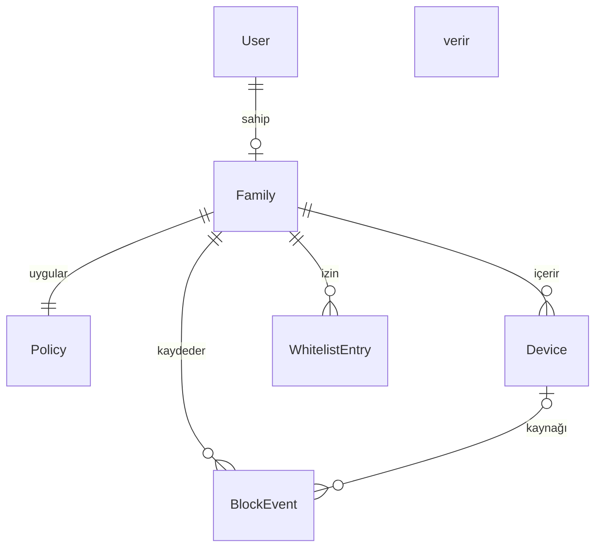

# FamSecur Web

**Müdahale etmeden, Aileni koru.**

FamSecur'un tanıtım sitesi, ebeveyn paneli ve yönetim paneli. Proje aynı zamanda
*Web Tabanlı Teknolojiler* dersi dönem sonu projesidir: birbirinden ayrı bir
REST API (Django REST Framework) ve bu API'yi kullanan bir web istemcisinden
(React) oluşur.

FamSecur, ev ağında DNS/router seviyesinde çalışan, gizlilik odaklı bir aile
internet kalkanıdır. Kumar/bahis, yetişkin içerik, uyuşturucu, oltalama ve
zararlı yazılım alan adlarını engeller; çocuğun mesajlarını, ekranını veya
gezinme geçmişini toplamaz. Karar motoru ana proje deposundan
([isaergisi/FamSecur](https://github.com/isaergisi/FamSecur)) bu API'ye
uyarlanmıştır.

## Çözülen problem

Ebeveyn kontrol uygulamalarının çoğu çocuğun cihazına kurulur ve mesajlar,
ekran ve geçmiş gibi kişisel verileri toplar. FamSecur yalnızca istenen alan
adına bakar, yalnızca **engellenen** istekleri kaydeder ve her engelin nedenini
açıklar. Bu site ebeveynin:

- hesap açıp ailesinin cihazlarını tanımlamasını,
- koruma politikasını (risk eşiği, sessiz/uyarılı engel, kategoriler) belirlemesini,
- yanlış engelleri beyaz listeyle düzeltmesini,
- engel olaylarını gerekçeleriyle incelemesini,
- bir alan adının cihazında engellenip engellenmeyeceğini test etmesini

sağlar. Yöneticiler ise kullanıcıları, iletişim taleplerini, SSS içeriğini ve
tüm ailelerde geçerli tehdit istihbaratı kaynaklarını yönetir.

## Ödev şartlarının karşılanması

| Şart | Karşılandığı yer |
| --- | --- |
| Backend REST API | `backend/` — Django 5 + Django REST Framework |
| CRUD işlemleri | Cihaz, beyaz liste, SSS, iletişim talebi, tehdit kaynağı, kullanıcı (yönetici) için tam CRUD; politika ve aile için okuma/güncelleme; olaylar için okuma/silme |
| Veritabanı, kalıcı veri | SQLite (Django ORM, migration'lar `*/migrations/`) |
| HTTP metotları | `GET`, `POST`, `PUT`, `PATCH`, `DELETE` |
| HTTP durum kodları | 200, 201, 204, 400, 401, 403, 404, 405, 409, 429 |
| Anlamlı hata mesajları | Tüm hatalar `{"detail": "...", "errors": {alan: [mesaj]}}` biçiminde Türkçe döner (`config/exceptions.py`) |
| İş kuralları backend'de | Karar motoru, aile bazlı veri izolasyonu, politika kuralları, olay saklama süresi (`shield/services.py`, `shield/serializers.py`) |
| Kayıt ve giriş | `POST /api/auth/register/`, `POST /api/auth/login/` |
| Kimlik doğrulama ve yetkilendirme | JWT (access + refresh), rol bazlı yetki: `parent` / `admin` (`accounts/permissions.py`) |
| Frontend ayrı uygulama | `frontend/` — React 19 + Vite + React Router |
| Frontend okuma/ekleme/güncelleme/silme | Ebeveyn ve yönetim panelindeki tüm sayfalar |
| Hata ve başarı durumlarını gösterme | Alan bazlı form hataları, uyarı kutuları, bildirim (toast) mesajları |
| Oturum yönetimi | Anahtarlar `localStorage`'da; süresi dolan erişim anahtarı otomatik yenilenir, yenilenemezse oturum kapatılır (`src/api.js`) |
| En az 5 veri modeli | 9 model (aşağıda) |
| Basit CRUD'dan öte | Açıklanabilir risk puanlamalı alan adı karar motoru, 36.000+ resmî kumar alan adı havuzu |
| Testler | 17 API testi (`backend/tests/test_api.py`) |

## Veri modelleri

| Model | Uygulama | Açıklama |
| --- | --- | --- |
| `User` | accounts | E-posta ile giriş yapan kullanıcı; `parent` veya `admin` rolü |
| `Family` | shield | Ebeveynin koruduğu ev (kullanıcıyla bire bir) |
| `Policy` | shield | Risk eşiği, engel biçimi, etkin kategoriler, olay saklama süresi |
| `Device` | shield | Ailenin cihazları; cihaz bazında koruma açılıp kapatılabilir |
| `WhitelistEntry` | shield | Ailenin izin verdiği alan adları (alt alan adları dahil) |
| `BlockEvent` | shield | Yalnızca engellenen istekler: alan adı, kategori, puan, gerekçe |
| `ThreatSource` | shield | Yöneticinin yönettiği tehdit istihbaratı kaynağı ve alan adları |
| `FAQ` | content | Sitedeki sıkça sorulan sorular |
| `ContactRequest` | content | Ziyaretçilerin demo/destek talepleri |



## İş kuralları

- Her ebeveyn yalnızca kendi ailesinin verisini görebilir; başka ailenin kaydı `404` döner.
- Kayıt olan her kullanıcıya otomatik olarak bir aile ve varsayılan politika (eşik 70, sessiz engel, tüm kategoriler) oluşturulur.
- Risk eşiği 30-100 arasında olmalıdır; oltalama ve zararlı yazılım kategorileri kapatılamaz.
- `POST /api/check/` alan adını şu sırayla değerlendirir: cihaz koruması → beyaz liste → aktif tehdit kaynakları → resmî kumar havuzu → açıklanabilir sinyal puanlaması.
- İzin verilen istekler **hiçbir yerde kaydedilmez**; engellenenler `BlockEvent` olarak yazılır, saklama süresi dolanlar silinir.
- Olaylar elle oluşturulamaz (`POST /api/events/` → `405`); yalnızca karar motoru üretir.
- Aynı ailede aynı adlı iki cihaz veya aynı alan adı iki kez beyaz listede olamaz.
- Yönetici kendi hesabını silemez, rolünü düşüremez veya kapatamaz.
- Herkese açık uç noktalar hız sınırlıdır (demo analizi 30/dk, iletişim formu 5/saat).

## API uç noktaları

| Metot | Yol | Yetki | Açıklama |
| --- | --- | --- | --- |
| POST | `/api/auth/register/` | Herkes | Kayıt; kullanıcı + JWT döner |
| POST | `/api/auth/login/` | Herkes | Giriş; JWT döner |
| POST | `/api/auth/refresh/` | Herkes | Erişim anahtarını yeniler |
| GET, PATCH | `/api/auth/me/` | Giriş | Profil |
| POST | `/api/auth/change-password/` | Giriş | Şifre değiştirme |
| GET, PATCH | `/api/family/` | Ebeveyn | Aile bilgisi ve özet |
| GET, PUT, PATCH | `/api/policy/` | Ebeveyn | Koruma politikası |
| GET, POST, PUT, PATCH, DELETE | `/api/devices/` | Ebeveyn | Cihazlar |
| GET, POST, PUT, PATCH, DELETE | `/api/whitelist/` | Ebeveyn | Beyaz liste (`?search=`) |
| GET, DELETE | `/api/events/` | Ebeveyn | Engel olayları (`?category=&device=&search=&page=`) |
| GET | `/api/events/stats/` | Ebeveyn | Kategori, cihaz, gün bazlı istatistik |
| DELETE | `/api/events/clear/` | Ebeveyn | Tüm olayları siler |
| POST | `/api/check/` | Ebeveyn | Alan adını aile politikasıyla değerlendirir |
| POST | `/api/analyze/` | Herkes | Sitedeki canlı demo (kayıt tutmaz) |
| GET / POST, PUT, PATCH, DELETE | `/api/faqs/` | Herkes / Yönetici | SSS |
| POST / GET, PUT, PATCH, DELETE | `/api/contact-requests/` | Herkes / Yönetici | İletişim talepleri |
| GET / POST, PUT, PATCH, DELETE | `/api/threat-sources/` | Herkes / Yönetici | Tehdit kaynakları |
| GET, POST, PUT, PATCH, DELETE | `/api/admin/users/` | Yönetici | Kullanıcı yönetimi |
| GET | `/api/admin/stats/` | Yönetici | Platform istatistikleri |

## Kurulum

Gereksinimler: Python 3.11+, Node.js 20+.

### Backend

```bash
cd backend
python -m venv .venv
source .venv/bin/activate        # Windows: .venv\Scripts\activate
pip install -r requirements.txt
python manage.py migrate
python manage.py seed_demo       # demo hesapları ve örnek veri
python manage.py runserver       # http://127.0.0.1:8000
```

Testler:

```bash
python manage.py test tests
```

### Frontend

```bash
cd frontend
npm install
npm run dev                      # http://localhost:5173
```

Geliştirmede Vite, `/api` isteklerini `http://127.0.0.1:8000` adresine yönlendirir.
API başka bir adresteyse `frontend/.env` dosyasında `VITE_API_URL` tanımlayın.

### Demo hesapları (`seed_demo` sonrası)

| Rol | E-posta | Şifre |
| --- | --- | --- |
| Yönetici | `admin@famsecur.com` | `Admin.12345` |
| Ebeveyn | `ebeveyn@famsecur.com` | `Ebeveyn.12345` |

### Üretim notları

`DJANGO_DEBUG=0`, `DJANGO_SECRET_KEY`, `DJANGO_ALLOWED_HOSTS` ve
`CORS_ALLOWED_ORIGINS` ortam değişkenlerini ayarlayın. Demo şifrelerini
kullanmayın.

## Proje yapısı

```
backend/
  config/      ayarlar, URL'ler, ortak hata biçimi
  accounts/    kullanıcı modeli, kayıt/giriş, rol izinleri, kullanıcı yönetimi
  shield/      aile, politika, cihaz, beyaz liste, olay, tehdit kaynağı, karar motoru
  content/     SSS, iletişim talepleri, seed_demo komutu
  tests/       API testleri
frontend/
  src/api.js            REST istemcisi (JWT, otomatik yenileme, hata yönetimi)
  src/auth.jsx          oturum durumu
  src/pages/public/     tanıtım sitesi, SSS, iletişim, giriş, kayıt
  src/pages/panel/      ebeveyn paneli
  src/pages/admin/      yönetim paneli
```
